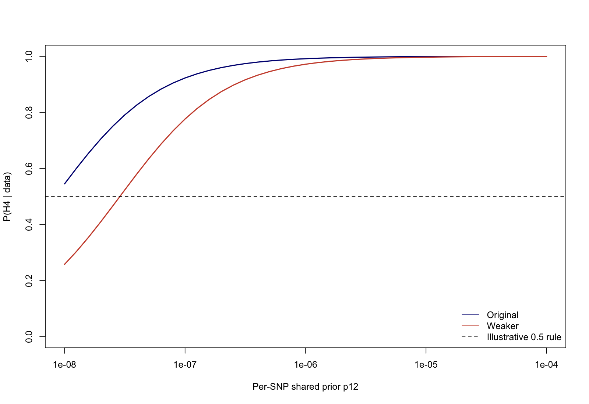

# Results from the verified run

Executed on 20 September 2026 with R 4.6.1, coloc 6.0.3 at the commit pinned in
`renv.lock`, and susieR 0.14.2. Every lesson completed, including the weak-signal
SuSiE extension and deprecated conditioning. The runner performs scientific
checks after execution; see [validation.txt](outputs/validation.txt) and
[session_info.txt](outputs/session_info.txt).

## What to look for

| Example | Observed result | Interpretation |
| --- | --- | --- |
| D1 versus D2, default ABF priors | H4 = 0.999166 | Strong support for a shared variant under this model. |
| Shared variant credible set | `s105`, conditional probability 0.988945 | One SNP reaches the conditional 95% threshold. |
| D1/D2 at `p12 = 1e-6` | H4 = 0.991723 | Support remains strong after reducing the shared prior. |
| Artificially weaker D1/D2 at `p12 = 1e-6` | H4 = 0.972028 | Still passes H4 > 0.5 at this particular prior. |
| SuSiE, `s105` versus `s105` | H4 = 0.999161 | One pair of signals supports sharing. |
| SuSiE, `s89` versus `s105` | H3 = 0.963106; H4 = 0.030469 | The other pair supports distinct signals. |
| Weak D5, credible-set coverage 0.95 / 0.10 | 0 / 1 credible sets | Lower coverage changes which signals can form sets. |
| First 100 SNPs given double prior weight | H4 = 0.999182 | Little change in this strong example. |
| Seeded TSS-distance weights for trait 1 | H4 = 0.998868 | Still strong support with this annotation and random coordinate draw. |
| Historical conditioning, shared / other pair | H4 = 0.988283 / 0.003522 | Illustrates an older route to separate signal comparisons. |

These are results for the bundled simulated examples, not biological findings
about real traits or PTPN22. Signal labels and numerical precision can vary with
package versions; read the exported tables rather than assuming an upstream row
number identifies a particular signal.

## Prior-sensitivity discrepancy in the source text

The [upstream sensitivity article](https://chr1swallace.github.io/coloc/articles/a04_sensitivity.html)
prints H4 approximately 0.972 for its weaker data at `p12 = 1e-6`, yet its prose
claims H4 > 0.5 only above approximately `1e-6`. The executed code does not support
that threshold. This section reproduces the hidden Rmd construction literally,
then exports an explicit grid to make the result checkable.

Within the tested grid from `1e-8` to `1e-4`, the first passing values for H4 > 0.5
are `1e-8` for the original data and approximately `3.1623e-8` for the weakened
data. These are **grid points**, not exact crossing estimates or recommended
prior choices.

## Reproduction details

The allele-alignment diagnostic gives 0.906150 for consistent coding and 0.500743
after deliberate beta/LD misalignment. It is a diagnostic score, not a posterior
probability of correct alignment.

The TSS example's fixed seed places one variant just outside the empirical density
grid. The lesson reports that it uses the nearest endpoint, matching the source's
nearest-bin rule. The website's random coordinate draw is not matched exactly.

Full SuSiE fits and coloc results are regenerated as local `objects.rds` files.
The committed CSV, PNG, and log files are the readable record of this run. The
environment was checked with `renv::status()` and found consistent; a fresh restore
on another operating system was not performed.
